I'm an enthusiastic developer who loves exploring new technologies, solving problems, and turning ideas into reality.
I'm passionate about <b>Data Engineering</b>, <b>AI/LLMs</b>, and <b>software development</b>, always experimenting with new tools and pushing myself to become a better engineer.
I believe in learning by building, improving through challenges, and creating technology that makes a real-world impact.

<table>
<tr>
<td width="50%" valign="top">

<h3><a href="https://github.com/Sanskar1724/FinSight_AI">FinSight AI</a></h3>
A personal finance workspace for India where the AI calculates first and writes second.
  🔬 <b>Research:</b> scores plain LLM answers against grounded answers on 28 real finance questions with a versioned rubric.
 🏭 <b>Practice:</b> <code>Decimal</code> finance engine, rate-limited auth, migrations, 77 tests, and CI for lint, types, and build.
  <code>React 19</code> <code>TypeScript</code> <code>FastAPI</code> <code>PostgreSQL</code> <code>PWA</code>
</td>
<td width="50%" valign="top">

<h3><a href="https://github.com/Sanskar1724/PayTrust_AI">PayTrust AI</a></h3>
Decides whether an AI agent may make a payment: <code>ALLOW</code>, <code>ASK_USER</code>, or <code>DENY</code>. Built for the Razorpay Buildathon.
  🔬 <b>Research:</b> fraud model on IEEE-CIS (590k transactions) with a time-based split; ROC-AUC 0.842, recall 0.823.
 🏭 <b>Practice:</b> deterministic policy gate, LLM kept advisory-only, HMAC-verified idempotent webhooks, 128 tests.
  <code>Python</code> <code>FastAPI</code> <code>scikit-learn</code> <code>Streamlit</code> <code>Razorpay</code>
</td>
</tr>
<tr>
<td width="50%" valign="top">

<h3><a href="https://github.com/Sanskar1724/MarginGraph">MarginGraph</a></h3>
Recommends add-ons that customers will buy and that keep the retailer profitable.
  🔬 <b>Research:</b> LightGBM beats EASE by 7 points Hit@10 on 4,480 real baskets; LLM rankers tested and documented as a no-go; written up as a paper.
 🏭 <b>Practice:</b> a MILP optimizer enforces a 15% margin floor with zero breaks, served through FastAPI with CI.
  <code>Python</code> <code>LightGBM</code> <code>PuLP</code> <code>FastAPI</code> <code>Gradio</code>
</td>
<td width="50%" valign="top">

<h3><a href="https://github.com/Sanskar1724/CampusOps">CampusOps</a></h3>
An academic agent that reads college email, timetables, and documents, then answers on web, Telegram, and email.
  🔬 <b>Research:</b> hybrid search (embeddings + keywords) with vision OCR across PDFs, photos, and spreadsheets.
 🏭 <b>Practice:</b> one agent core for every channel, deterministic LLM fallback, JWT auth, Docker, 62 tests.
  <code>Python</code> <code>FastAPI</code> <code>Next.js</code> <code>PostgreSQL</code> <code>pgvector</code>
</td>
</tr>
</table>

<picture>
  <source media="(prefers-color-scheme: dark)" srcset="profile-3d-contrib/profile-night-rainbow.svg"/>
  <source media="(prefers-color-scheme: light)" srcset="profile-3d-contrib/profile-green-animate.svg"/>
  
</picture>
