I'm an enthusiastic developer who loves exploring new technologies, solving problems, and turning ideas into reality.
I'm passionate about <b>Data Engineering</b>, <b>AI/LLMs</b>, and <b>software development</b>, always experimenting with new tools and pushing myself to become a better engineer.
I believe in learning by building, improving through challenges, and creating technology that makes a real-world impact.

<table>
<tr>
<td width="50%" valign="top">

<h3><a href="https://github.com/Sanskar1724/AI-Product-Studio">FORGE// AI Product Studio</a></h3>
A studio site for AI solutions, software, automation, data products, and rapid MVPs.
  <code>React</code> <code>TypeScript</code> <code>Vite</code> <code>Tailwind</code> <code>Framer Motion</code>
</td>
<td width="50%" valign="top">

<h3><a href="https://github.com/Sanskar1724/CampusOps">CampusOps</a></h3>
Reads email, timetables, and documents, then sends a daily brief over web, Telegram, and email.
  <code>Python</code> <code>FastAPI</code> <code>Next.js</code> <code>PostgreSQL</code> <code>pgvector</code>
</td>
</tr>
</table>

<picture>
  <source media="(prefers-color-scheme: dark)" srcset="profile-3d-contrib/profile-night-rainbow.svg"/>
  <source media="(prefers-color-scheme: light)" srcset="profile-3d-contrib/profile-green-animate.svg"/>
  
</picture>
