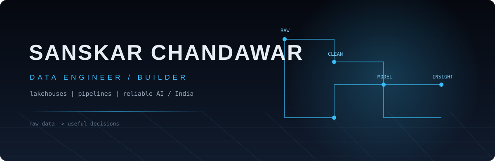
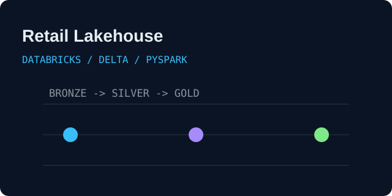
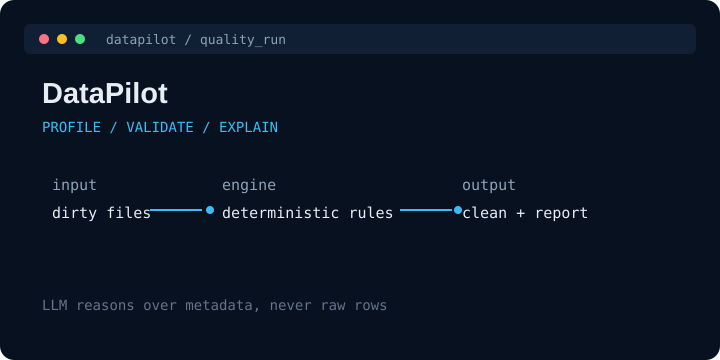
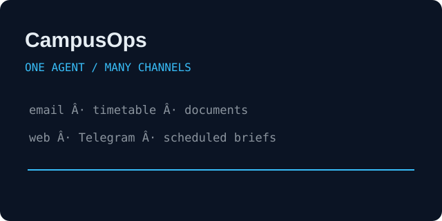
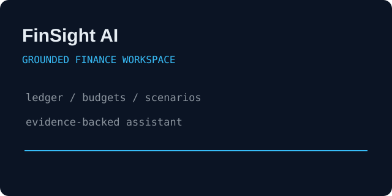
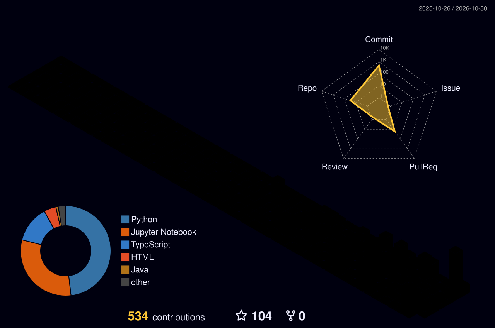

&nbsp;
&nbsp;
&nbsp;

  

I build data pipelines that make messy information trustworthy, and software that makes the result useful.

 

 

<table>
<tr>
<td width="50%"></td>
<td width="50%"></td>
</tr>
<tr>
<td width="50%"></td>
<td width="50%"></td>
</tr>
</table>

<a href="https://github.com/Sanskar1724"><b>All repositories and project documentation on GitHub &rarr;</b></a>

| | |
|---|---|
| **Data engineering** | PySpark · Apache Spark · Databricks · Delta Lake · Unity Catalog · SQL · data quality · dimensional modeling |
| **Backend and code** | Python · FastAPI · SQLAlchemy · Pydantic · TypeScript · React · Next.js · REST APIs |
| **AI applications** | RAG · hybrid search · OpenRouter · prompt design · grounded assistants · deterministic fallbacks |
| **Cloud and operations** | PostgreSQL · SQLite · Docker · GitHub Actions · Power BI |

 

<picture>
  <source media="(prefers-color-scheme: dark)" srcset="profile-3d-contrib/profile-night-rainbow.svg"/>
  <source media="(prefers-color-scheme: light)" srcset="profile-3d-contrib/profile-green-animate.svg"/>
  
</picture>

 

Open to conversations about data platforms, backend systems, and practical AI applications · <a href="mailto:sanskarchandawar3@gmail.com">sanskarchandawar3@gmail.com</a>

