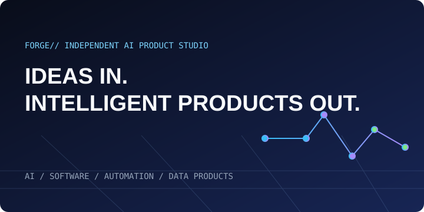

<table>
<tr>
<td width="50%" valign="top">

<h3><a href="https://github.com/Sanskar1724/AI-Product-Studio">FORGE// · AI Product Studio</a></h3>
An independent studio interface that turns ideas into software, automations, data products, and MVPs.
  <code>React</code> <code>TypeScript</code> <code>Vite</code> <code>Tailwind</code> <code>Framer Motion</code>
  <a href="https://forgeaistudio.vercel.app">Live site ↗</a>
</td>
<td width="50%" valign="top">

<h3><a href="https://github.com/Sanskar1724/CampusOps">CampusOps · Academic AI Agent</a></h3>
Pulls email, timetable, and documents together, then delivers one useful brief over web, Telegram, and email.
  <code>Python</code> <code>FastAPI</code> <code>Next.js</code> <code>PostgreSQL</code> <code>pgvector</code>
  <a href="https://github.com/Sanskar1724/CampusOps">View repo ↗</a>
</td>
</tr>
</table>

<picture>
  <source media="(prefers-color-scheme: dark)" srcset="profile-3d-contrib/profile-night-rainbow.svg"/>
  <source media="(prefers-color-scheme: light)" srcset="profile-3d-contrib/profile-green-animate.svg"/>
  
</picture>
 
Open to AI product and data engineering work · <a href="mailto:sanskarchandawar3@gmail.com">sanskarchandawar3@gmail.com</a>

