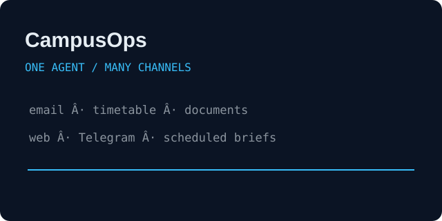
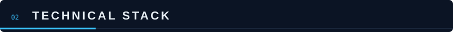
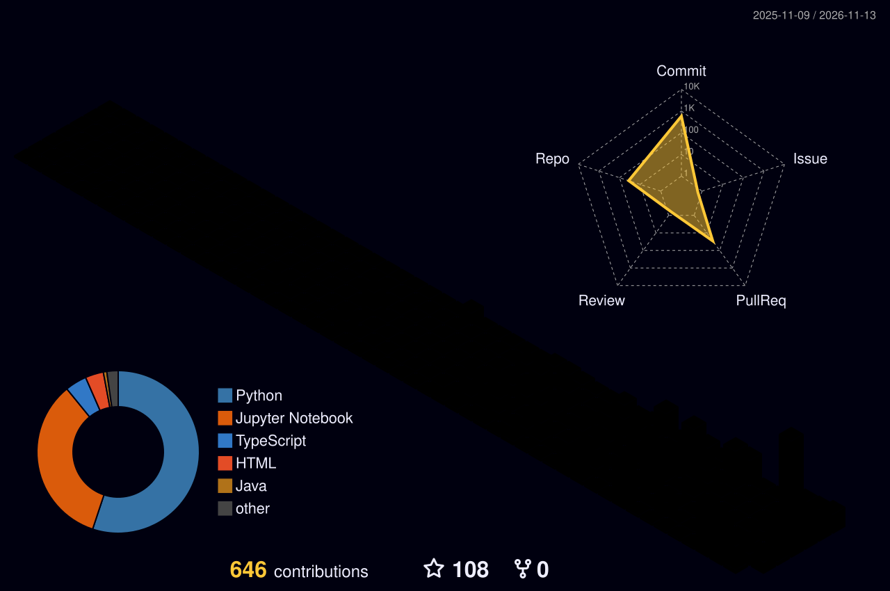

I'm an enthusiastic developer who loves exploring new technologies, solving problems, and turning ideas into reality.
I'm passionate about <b>Data Engineering</b>, <b>AI/LLMs</b>, and <b>software development</b>, always experimenting with new tools and pushing myself to become a better engineer.
I believe in learning by building, improving through challenges, and creating technology that makes a real-world impact.

<table>
<tr>
<td width="50%" valign="top">

<h3><a href="https://github.com/Sanskar1724/FinSight_AI">FinSight AI</a></h3>
A personal finance workspace for India where the AI calculates first and writes second.

🔬 **Research** on five public benchmarks
- Computing with code lifts **FinQA from 48.7% to 71.0%**; 82.6% correct when two methods agree
- Routing with bge-m3 reaches **93.4% on Banking77** (vs 65.5%)
- Retrieval scores **nDCG@10 0.410 on FiQA** (vs 0.236 for BM25)

Memory and agent results

- Conversation memory lifts ConvFinQA follow-ups from 48% to 63% and doubles fully correct conversations (21% → 42%)
- Router + specialists match one agent on TAT-QA (43.3% vs 46.3%, within noise) with 22% fewer tokens

🏭 **Engineering:** `Decimal` finance engine, rate-limited auth, migrations, 77 tests, CI for lint, types, and build.

`React 19` `TypeScript` `FastAPI` `PostgreSQL` `PWA`
</td>
<td width="50%" valign="top">

<h3><a href="https://github.com/Sanskar1724/MarginGraph">MarginGraph</a></h3>
Recommends add-ons that customers will buy and that keep the retailer profitable.

🔬 **Research** on five real retail datasets
- LightGBM hits **38.1% Hit@10** on 4,480 UCI baskets and holds up on Ta Feng, Dunnhumby, and Instacart
- A 30-day checkout replay earns **+24% add-on profit** over the ranker alone, with 0 margin-floor breaks vs 164
- 📄 Written up as a 19-page preprint: [*Margin-Aware, Constrained Recommendation of Checkout Add-Ons*](https://github.com/Sanskar1724/MarginGraph/blob/main/paper/main.pdf)

Per-dataset results and caveats

- Ta Feng +8.3 pts, Dunnhumby +9.8, Instacart +4.1 (once past purchases fill the pool first), a tie on small Olist
- +19% profit across 5 seeds; cost and stock are simulated
- LLM rankers were tested and documented as a no-go

🏭 **Engineering:** MILP optimizer enforces a 15% margin floor, served through FastAPI with CI at p50 22 ms.

`Python` `LightGBM` `PuLP` `FastAPI` `Gradio`
</td>
</tr>
<tr>
<td width="50%" valign="top">

<h3><a href="https://github.com/Sanskar1724/PayTrust_AI">PayTrust AI</a></h3>
Decides whether an AI agent may make a payment: `ALLOW`, `ASK_USER`, or `DENY`. Built for the Razorpay Buildathon.

🔬 **Research** on IEEE-CIS fraud data
- Trained on **590k transactions** with a time-based split, never loaded whole
- **ROC-AUC 0.842, recall 0.823**, with a threshold tool to trade precision for recall

🏭 **Engineering:** deterministic policy gate, LLM kept advisory-only, HMAC-verified idempotent webhooks, 128 tests.

`Python` `FastAPI` `scikit-learn` `Streamlit` `Razorpay`
</td>
<td width="50%" valign="top">

<h3><a href="https://github.com/Sanskar1724/CampusOps">CampusOps</a></h3>
An academic agent that reads college email, timetables, and documents, then answers on web, Telegram, and email.

🔬 **Retrieval**
- **Hybrid search** (embeddings + keywords) over PDFs, photos, and spreadsheets
- **Vision OCR** turns timetable photos and portal PDFs into searchable records

🏭 **Engineering:** one agent core for every channel, deterministic LLM fallback, JWT auth, Docker, 62 tests.

`Python` `FastAPI` `Next.js` `PostgreSQL` `pgvector`
</td>
</tr>
</table>

<picture>
  <source media="(prefers-color-scheme: dark)" srcset="profile-3d-contrib/profile-night-rainbow.svg"/>
  <source media="(prefers-color-scheme: light)" srcset="profile-3d-contrib/profile-green-animate.svg"/>
  
</picture>
